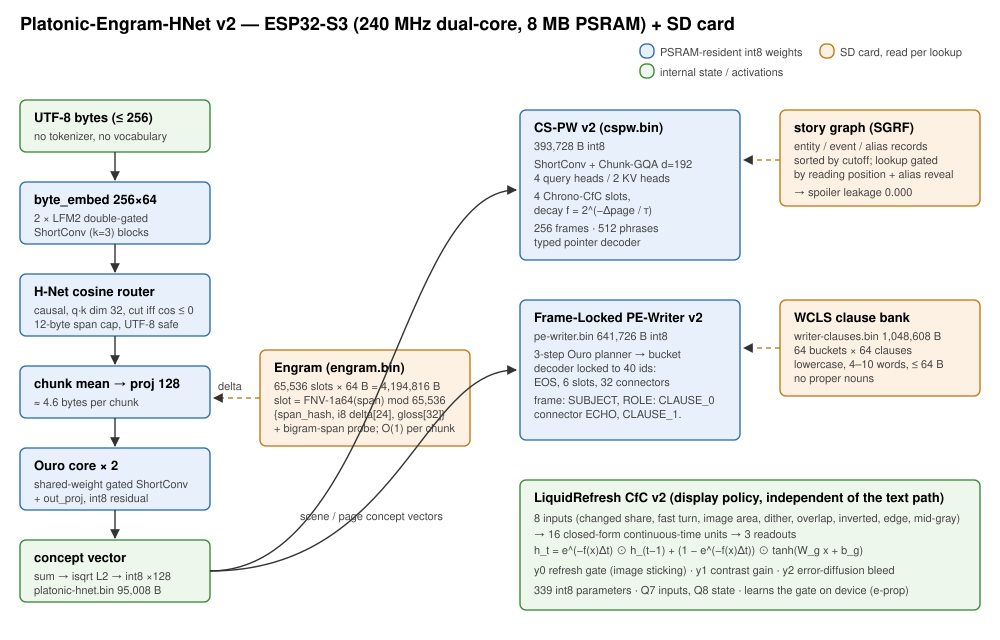
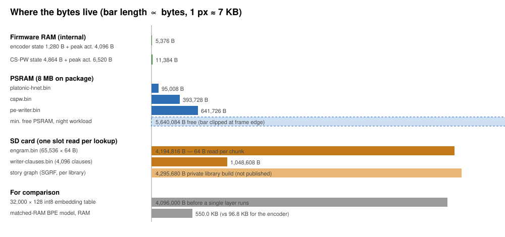

# Architecture

The system has four learned parts and three data files. Weights live in PSRAM. Large tables live on the SD card and are read one fixed-size slot at a time. All runtime arithmetic is integer. The Python integer reference (`src/model.py` `PlhnIntNp`, `src/cspw_model.py`, `src/pe_writer_model.py`), the C int8 kernel and the firmware agree bit for bit.

## 1. Platonic-Engram-HNet v2 encoder (`platonic-hnet.bin`, PLHN v1)

Bytes in, one int8 128-d concept vector out:

1. **Bytes.** Up to 256 UTF-8 bytes per window. There is no tokenizer and no vocabulary.
2. **Byte embedding.** `byte_embed` 256×64 (d_byte = 64).
3. **Two LFM2-style double-gated ShortConv blocks** (depthwise k=3, pointwise, gate).
4. **H-Net cosine router.** `router_q`, `router_k` 64×32 (router_dim 32). The router is causal, with a 6-byte receptive field. A chunk boundary is placed where the query/key cosine says a word starts. Spans are capped at 12 bytes and never cut inside a UTF-8 character. Training applies a class-balanced hinge on jieba word starts, pushing them to cos ≤ −0.2 and inside lead bytes to ≥ +0.2. Mean chunk length is 4.60 bytes.
5. **Chunk mean → `chunk_proj`** 64×128 (d_concept = 128).
6. **Engram delta.** slot = FNV-1a64(span bytes) mod 65,536. The slot's int8 delta is added to the first 24 dims. The **Bigram-span Engram** works the same way: for chunk c ≥ 1 with len(c−1)+len(c) ≤ 18, h2 = FNV-1a64(bytes of both chunks), applied only when the slot's stored span_hash equals h2.
7. **Ouro core ×2.** Two loops of one shared-weight gated ShortConv + `core_out_proj` (128×128).
8. **Readout.** Sum over chunks → integer-sqrt L2 normalisation → int8 ×128.

Training: LeJEPA identity + SIGReg (λ = 0.02) plus InfoNCE cross-lingual alignment between Chinese context sentences and English dictionary definitions. Quantisation-aware training is applied in the int8 graph.

### Binary layout (95,008 B = 32 B header + 94,976 int8)

| Tensor | Shape | Scale group | Offset | Bytes |
|---|---|---|---:|---:|
| header | — | — | 0 | 32 |
| byte_embed | 256×64 | embed | 32 | 16,384 |
| conv1_dw | 64×3 | proj | 16,416 | 192 |
| conv1_pw | 64×64 | proj | 16,608 | 4,096 |
| conv1_gate | 64×64 | proj | 20,704 | 4,096 |
| conv2_dw | 64×3 | proj | 24,800 | 192 |
| conv2_pw | 64×64 | proj | 24,992 | 4,096 |
| conv2_gate | 64×64 | proj | 29,088 | 4,096 |
| router_q | 64×32 | router | 33,184 | 2,048 |
| router_k | 64×32 | router | 35,232 | 2,048 |
| chunk_proj | 64×128 | proj | 37,280 | 8,192 |
| core_conv_dw | 128×3 | core | 45,472 | 384 |
| core_conv_pw | 128×128 | core | 45,856 | 16,384 |
| core_gate | 128×128 | core | 62,240 | 16,384 |
| core_out_proj | 128×128 | core | 78,624 | 16,384 |

Four scale groups (`embed`, `router`, `proj`, `core`). Firmware RAM: 1,280 B persistent state and 4,096 B peak activations.

## 2. Engram hash table (`engram.bin`, ENGR v1)

4,194,816 B = 512 B header (`<IIIIf`: magic `ENGR`, version, num_slots = 65,536, slot_bytes = 64, scale; padded to 512 B) + 65,536 slots of 64 B:

| Field | Bytes | Meaning |
|---|---:|---|
| `span_hash` | 8 | u64 FNV-1a64 of the dominant router span (bigram gate key) |
| `concept_delta` | 24 | int8 delta added to concept dims 0–23 |
| `gloss` | 32 | NUL-padded UTF-8 gloss (display only; the encoder never reads it) |

The table stays on the SD card. The firmware reads one 64-byte slot per chunk, plus one more per bigram probe. The deployed table has 58,554 slots with a span hash and 8,526 with a gloss. The published public-gloss build keeps 7,997 glosses (see the model card).

## 3. Chrono-Slot Pointer Weaver v2 (`cspw.bin`, CSPW v2)

CS-PW turns gated story-graph events into short, spoiler-free refreshers about an entity.

- **Memory.** Four Chrono-CfC slots (D_SLOT = 128) whose memory decays as f = 32768 · 2^(−Δpage/τ) (Q15).
- **Mixer.** ShortConv + Chunk-GQA at d_model = 192 with 4 query heads and 2 KV heads (head dim 48).
- **Decoder.** A typed pointer decoder over 256 frame templates and 512 role/phrase entries, all generic text with no names.
- **Spoiler gate.** Events come from the SGRF story graph, sorted by reading cutoff. A lookup returns only events at or before the reader's current position. Aliases are revealed only after their reveal point.

| Tensor | Shape | Offset | Bytes |
|---|---|---:|---:|
| header | — | 0 | 512 |
| up_proj | 128×192 | 512 | 24,576 |
| gqa_q | 192×192 | 25,088 | 36,864 |
| gqa_k | 192×96 | 61,952 | 18,432 |
| gqa_v | 192×96 | 80,384 | 18,432 |
| gqa_o | 192×192 | 98,816 | 36,864 |
| down_proj | 192×128 | 135,680 | 24,576 |
| salience_w / salience_b | 128 / — | 160,256 / 160,384 | 128 / 128 |
| slot_gate_w | 4×128×128 | 160,512 | 65,536 |
| frame_bank | 256×128 | 226,048 | 32,768 |
| frame strings | 256 × 64 B | 258,816 | 16,384 |
| phrase_bank | 512×128 | 275,200 | 65,536 |
| phrase strings | 512 × 100 B | 340,736 | 51,200 |
| tail (zero) | — | 391,936 | 1,792 |

Firmware RAM: 4,864 B state, 6,520 B peak activations.

### Story graph (`story-graph.idx`, SGRF v1)

The SGRF file has a 512-byte header (`<4sHHIIIIII`: magic, version, flags, entity/event/alias counts and section offsets). It is followed by 64-byte entity records (term hash, book hash, first cutoff, kind, name/role, event range) and 256-byte event records (cutoff, chapter/page, slot and salience hints, event gloss, int8 scene vector), both sector-aligned. Last come the 24-byte alias records (alias hash, canonical hash, reveal cutoff). The story graph is **built per reader from that reader's own library**, so it is never published. The device build is 4,295,680 B: 2,532 entities, 16,137 events, 62 aliases. The public BookSum build is 1,441,280 B: 439 entities, 5,517 events, 0 aliases. It reproduces the published benchmark (spoiler leakage 0.000 on 9,169 queries).

## 4. Frame-Locked PE-Writer v2 (`pe-writer.bin` PEWR + `writer-clauses.bin` WCLS)

PE-Writer v2 writes a one-sentence "riff" about a concept without ever improvising a content word.

- **Planner.** A 3-step Ouro planner (`step_embed`, `plan_fc1`, `plan_fc2`) routes each step to one of 64 role-partitioned clause buckets.
- **Decoder.** A gated ShortConv decoder (d = 128, T_max = 36). It is frame-locked: only `<EOS>`, the 6 slot specials and 32 connector pieces (ids 8–39) can win the argmax. The other 2,008 `lm_head` rows have W = 0 and bias −30000.
- **Frame.** `<ENT_SUBJECT>, <ENT_ROLE>: <CLAUSE_0> <connector> <BOOK_ECHO>, <CLAUSE_1>.<EOS>`. Clause slots are filled from the WCLS bank on the SD card, which holds 4,096 lowercase clauses of 4–10 words with no proper nouns.

| Tensor | Kind | Shape | Offset | Bytes |
|---|---|---|---:|---:|
| header | — | — | 0 | 32 |
| step_embed | raw int8 | 3×128 | 32 | 384 |
| plan_fc1 | lin | 128×128 | 416 | 16,644 |
| plan_fc2 | lin | 128×128 | 17,060 | 16,644 |
| bucket_centroids | raw int8 | 64×128 | 33,704 | 8,192 |
| tok_embed | raw int8 | 2048×128 | 41,896 | 262,144 |
| pos_embed | raw int8 | 36×128 | 304,040 | 4,608 |
| conv_in_gate | lin | 128×128 | 308,648 | 16,644 |
| conv_dw | lin | 128×3 | 325,292 | 644 |
| conv_out_proj | lin | 128×128 | 325,936 | 16,644 |
| lm_head | lin | 2048×128 | 342,580 | 266,244 |
| copy_gate_proj | lin | 1×128 | 608,824 | 134 |
| vocab strings | — | 2048 × 16 B | 608,958 | 32,768 |

`lin` = float32 scale + int16 bias[out] + int8 W[out][in]. WCLS = 32 B header + 64 buckets × 64 slots × 256 B = 1,048,608 B.

## 5. LiquidRefresh CfC v2 (firmware display policy)

A closed-form continuous-time (CfC) cell, 8 inputs → 16 units → 3 readouts:

$$h_t = e^{-f(x_t)\Delta t} \odot h_{t-1} + \left(1 - e^{-f(x_t)\Delta t}\right) \odot \tanh(W_g x_t + b_g),\quad f(x) = \mathrm{softplus}(W_f x + b_f)$$

- **Inputs (Q7).** Changed share, fast turn, image area, dither, image overlap, inverted (night), edge density, mid-gray share.
- **Units.** Units 0–5 model reversible text charge. Units 6–11 model image sticking. Units 12–15 serve the dither head.
- **Readouts.** y0 is the refresh gate, which learns on the device by e-prop. y1 is contrast gain, clamped to Q8 240–312. y2 is error-diffusion bleed, clamped to Q8 160–256.
- **Parameters.** W_f 16×8, b_f 16, W_g 16×8, b_g 16, W_out 3×16, b_out 3: 339 int8 bytes in total. The hidden state is Q8.

## 6. Memory budget

| Where | Contents | Bytes |
|---|---|---:|
| Internal RAM | encoder state + peak activations | 1,280 + 4,096 |
| Internal RAM | CS-PW state + peak activations | 4,864 + 6,520 |
| PSRAM | `platonic-hnet.bin` + `cspw.bin` + `pe-writer.bin` | 95,008 + 393,728 + 641,726 |
| SD | `engram.bin`, `writer-clauses.bin`, `story-graph.idx` | 4,194,816 + 1,048,608 + per-library |
| PSRAM headroom | minimum free during the night-reading workload | 5,640,084 |

Pareto accounting from the benchmark: the deployed encoder (E3) uses 96.8 KB RAM and 4,189.3 KB flash+SD. Encoder + Engram + CS-PW uses 487.6 KB RAM and 4,573.8 KB. The matched-RAM BPE model uses 550.0 KB RAM and 137.5 KB flash.

## 7. Private per-reader indexes (never published)

| File | Format | Bytes | Why it is private |
|---|---|---:|---|
| `story-graph.idx` | SGRF v1 | 4,295,680 | built from the owner's library (character names, event glosses) |
| `inbox-concepts.idx` | ICPT v1, 16 B header + 192 B records | 96,784 | concept index of the owner's book inbox (504 records / 126 books) |
