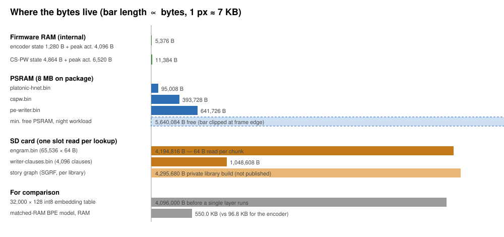

# Platonic-Engram-HNet

**Running Bilingual Word Sense, Spoiler-Free Character Memory, and Zero-Hallucination Generation in 1.1 MB of Microcontroller RAM — From Qwen3-32B H200 Distillation & 14 Controlled Ablations to Bit-Exact int8 C11/C++20 Firmware**

I wanted three things from the cheap e-reader I read on (an ESP32-S3 microcontroller with 8 MB of PSRAM): tap an English or Chinese word and get the meaning it has in that sentence, ask "who is this character again?" on page 40 without spoiling page 300, and get short margin notes that never invent a name or stop mid-sentence.

Shrinking a standard language model does not get you there. Below a megabyte it fails in three separate places:

- **The dictionary doesn't fit.** A 32,000-token vocabulary table at width 128 takes 4,096,000 bytes even at 8-bit precision, before a single layer runs. That alone is more RAM than the reader can spare next to its page buffers.
- **Search spoils the book.** Ordinary retrieval looks through the whole book, so a question asked on page 40 can be answered from page 300.
- **Tiny models can't finish a sentence.** My micro-model break off mid-sentence in 51.2% of its notes and invents a character name in 26.1%.

So I designed the models and the hardware memory layout together. The models were distilled from Qwen3-32B teachers on H200 GPUs and chosen through 14 controlled ablation arms; each one is placed where the device can afford it, in fast PSRAM or on the SD card the reader already uses to store books:

1. **Split compute from the dictionary — 96.8 KB of RAM vs 550 KB for a subword (BPE) model, 5.7× smaller.** A 95 KB 8-bit byte router in PSRAM reads raw UTF-8 and finds English and Chinese word boundaries, beating a BPE tokenizer given the same RAM by +7.2, +9.5 and +6.0 F1 points on three Chinese segmentation benchmarks. Word meanings live in a 4.2 MB hash table on the SD card, read one 64-byte slot per word.
2. **Hard-causal character memory — 0.00% spoilers across 9,169 BookSum queries.** Four continuous-time character slots in PSRAM (394 KB) fade with page distance and sit behind a gate on your current page offset. It still keeps each character's earliest and latest scenes in the right order 99.46% of the time (temporal-swap accuracy 0.9946). Remove the gate and spoiler leakage is 100%.
3. **Clause-locked generation — 0.00% broken sentences and 0.0% invented names across 4,226 public tests.** Instead of decoding token by token, a 3-step planner (642 KB) picks whole clauses from a 4,096-entry bank on the SD card, none of which contains a proper noun.
4. **Bit-exact integer parity — 0 mismatches from PyTorch QAT → NumPy → C11 → C++20 firmware.** Verified on 38,580 / 38,580 benchmark lines and 1,067 / 1,067 firmware unit tests. The C kernel answers a query in a median 6.0 ms on an Apple M1 host, and with every model loaded the device keeps 5.64 MB of PSRAM free.



## How to use

```bash
pip install numpy
python quickstart.py   # checks SHA256SUMS, then: word splitting + meaning vectors, a spoiler-safe BookSum recap, a margin note
```

`plhn_model.py`, `cspw_model.py` and `pe_writer_model.py` are bit-exact integer references of the firmware and need only NumPy.

```python
import plhn_model as M

enc = M.PlhnIntNp(open("weights/platonic-hnet.bin", "rb").read(),
                  open("weights/engram.bin", "rb").read())
a = enc.forward("The river bank was flooded after the storm.")   # 128 int8 values
b = enc.forward("河岸在暴风雨后被淹没了。")
cos = sum(x * y for x, y in zip(a, b)) / (127 * 127)
data, spans, _ = enc.chunk_states("他笑着说，明天再去山上看看。")  # the learned word chunks
```

Inputs longer than 256 bytes should be split into sentence-packed windows of at most 256 bytes; sum the per-window vectors, then re-normalise with `M.l2_int8`.

## At a glance

| What it does | This system (`1.13 MB` total RAM) | Standard baseline at the same budget |
|---|---|---|
| **Word reader RAM in firmware** (`platonic-hnet.bin` + `engram.bin`) | **96.8 KB RAM** (+ 4.2 MB on SD card) | 550.0 KB RAM for a subword (BPE) tokenizer (**5.7× larger**) |
| **Chinese word splitting & English word sense** | **+7.2 / +9.5 / +6.0 F1** over BPE on 3 Chinese benchmarks · **5 wins, 6 ties, 1 loss** across 12 public sentence tasks | Matched-RAM BPE (140,800 parameters) |
| **Spoiler-free character recaps** (`cspw.bin`, `394 KB`) | **0.00% spoilers** across 9,169 BookSum questions · **99.46%** scene-order accuracy | **100% spoiler leakage** when the page gate is removed |
| **Margin notes** (`pe-writer.bin`, `642 KB` + `1 MB` SD clause bank) | **0.00% broken sentences · 0.0% invented names** across 4,226 public tests | **51.2% broken sentences · 26.1% invented names** with token-by-token decoding |
| **E-ink screen refresh controller** (`LiquidRefresh`, `339 B`) | **99.9%** refresh decision accuracy across 1,500 episodes (cuts full-screen flashes) | Fixed page-count rule |
| **Python → C11 → C++20 firmware match** | **0 bit mismatches** across 38,580 benchmark lines & 1,067 firmware tests (`6.0 ms` median C query) | — |

**Where this 95 KB model still loses (and why it is not a general-purpose server embedding model):** Because the byte router caps chunks at 12 UTF-8 bytes and fits in 95 KB of RAM, it splits 5+ character Chinese compounds, loses to 200 MB+ server models (and often to keyword search) on whole-sentence matching, and trails a static slot template on reference similarity. The `model-index` metadata scores above come from the project's own re-run of the MTEB/C-MTEB protocols (`verified: false`). Every win, loss, and 14-arm ablation table is in [BENCHMARKS.md](https://github.com/bobzhou-source/platonic-engram-hnet/blob/main/BENCHMARKS.md), and the model internals are in [ARCHITECTURE.md](https://github.com/bobzhou-source/platonic-engram-hnet/blob/main/ARCHITECTURE.md).
## Weights

All files are in `weights/` and listed in `weights/SHA256SUMS`.

| File | Bytes | Lives in | What it is | sha256 |
|---|---:|---|---|---|
| `platonic-hnet.bin` | 95,008 | PSRAM | byte encoder and word router (94,976 int8 parameters) | `8477cd568bfd931c08ffb22588679e7e2d3589d4669b2eff8a76e5395a91b8bb` |
| `engram.bin` (public-gloss build) | 4,194,816 | SD card | 65,536 × 64-byte word slots: int8 meaning correction + short gloss | `8d6cac53f8f3038559ab71fa6e6aadc879eb9ef89cf66385cf225430615b228c` |
| `cspw.bin` | 393,728 | PSRAM | spoiler-free character memory | `cbce25c6a4fa4b215993d54c7d88c731d34004f2756fba83a9f6b8e7468dcffd` |
| `pe-writer.bin` | 641,726 | PSRAM | clause-locked margin-note writer | `962f317e22b30b8efe03aa67e5d440d6199e11ec25d96c46c9bcac6582c6cfcc` |
| `writer-clauses.bin` | 1,048,608 | SD card | 4,096 lowercase clauses, 4–10 words, no proper nouns | `7b0e3612c81d81764096c57fc6f1046abdc2a72ce9786e039861121b72d81023` |
| `booksum-story-graph.idx` | 1,441,280 | SD card | public BookSum character map: 439 characters, 5,517 events, 21 public-domain books | `cf308bcee87035c81dc00920a9224f83a7984167d6b5f81bbcb7c3bce209ef36` |

**Not published.** The device also holds a character map (`story-graph.idx`, 4,295,680 B: 2,532 characters, 16,137 event glosses and 62 aliases) and a concept index (`inbox-concepts.idx`, 96,784 B: 504 records from 126 books), both built from my personal library.

**Public-gloss `engram.bin`.** The device build (sha256 `2e7f1ec8…0be1`) has 529 glosses derived from the private reading corpus, such as character and clan names. [`tools/build_public_engram.py`](https://github.com/bobzhou-source/platonic-engram-hnet/blob/main/tools/build_public_engram.py) rewrites only the 32-byte gloss column and keeps a gloss only when it is a verbatim public-dictionary entry: 4,903 from CC-CEDICT (matched by hash and first sense), 3,090 from Open English WordNet, and 4 hyphenated WordNet headwords. The other 529 are blanked. The header, hashes and int8 corrections are byte-identical (`header_hash_delta_columns_identical: true` in `weights/engram.public-gloss.report.json`), and the encoder never reads glosses, so its output matches the device build bit for bit.

## Training data

- **Encoder and SD table.** A private Chinese/English reading corpus of 105,363 documents (not redistributed), dictionary pairs from CC-CEDICT and Open English WordNet, and jieba 0.42.1 word boundaries to teach the router. No benchmark data was used for training, tuning or selection. The table's hashes are one-way FNV-1a64 values, and the public glosses are dictionary text only.
- **Character memory and writer.** Generic template text and lowercase commentary clauses with no proper nouns; the clause bank was mined from the internal training split.
- **BookSum character map.** The BookSum chapter-level test split (`kmfoda/booksum`): 21 public-domain books (Project Gutenberg texts), with events taken from the BookSum chapter summaries.

## Technical details

- [ARCHITECTURE.md](https://github.com/bobzhou-source/platonic-engram-hnet/blob/main/ARCHITECTURE.md): how each model works, binary layouts, RAM budget and integer arithmetic.
- [BENCHMARKS.md](https://github.com/bobzhou-source/platonic-engram-hnet/blob/main/BENCHMARKS.md): every public benchmark table, wins and losses.
- [GitHub repo](https://github.com/bobzhou-source/platonic-engram-hnet): training code, benchmark runners, parity tests and firmware.

## License and attribution

Code and weights are MIT, with two exceptions:

- **Glosses inside `engram.bin`.** Adapted from CC-CEDICT (CC BY-SA 4.0, © CC-CEDICT contributors, MDBG) and Open English WordNet (CC BY 4.0, © the Open English WordNet team, derived from Princeton WordNet 3.1).
- **`booksum-story-graph.idx`.** Derived from BookSum (Kryściński et al., 2021). Its event glosses are fragments of BookSum's chapter summaries, which come from study-guide sites (e.g. SparkNotes, GradeSaver, CliffsNotes, Shmoop). Check BookSum's terms before redistributing.
