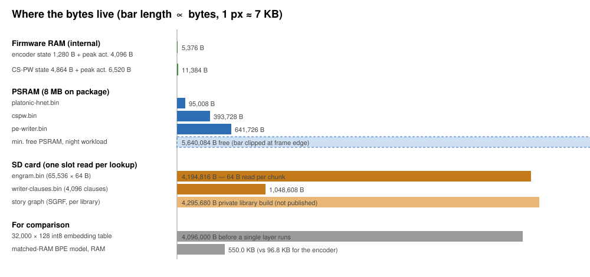

# Platonic-Engram-HNet

**No Room for a Tokenizer: Running a Bilingual Neural Reader in 95 Kilobytes of Microcontroller RAM**

Author: **Robert Zhou** ([robertzhou.dev](https://robertzhou.dev/work/platonic-engram-hnet/) · [GitHub](https://github.com/bobzhou-source/platonic-engram-hnet) · [ORCID 0009-0009-2155-7215](https://orcid.org/0009-0009-2155-7215))

When you read a book on a cheap e-reader (mine runs on an ESP32-S3 microcontroller with 8 MB of RAM), you want three simple things while you read:

1. **Tap a word in English or Chinese** and get the right definition for how it is used in that sentence.
2. **Ask "Who is this character again?"** on page 40 and get a recap of what they have done *up to page 40*, without spoiling page 300.
3. **Get short margin notes** that sum up the scene without making up fake character names or stopping mid-sentence.

A normal AI model can't even load its dictionary on a chip this small: a 32,000-word vocabulary table alone takes more memory than the e-reader has free. **Platonic-Engram-HNet** makes all three features work in **1.1 MB of RAM** by keeping a tiny 95 KB byte reader in memory and streaming the dictionary and phrase bank off the SD card the e-reader already uses to store books.



## What ships in the box

| Feature | What it does for the reader | Size |
|---|---|---:|
| **Word sense & bilingual reader** (`platonic-hnet.bin` + `engram.bin`) | Splits English and Chinese text into words using 95 KB of RAM, then looks up each word's meaning in a 4.2 MB table on the SD card | 95 KB RAM + 4.2 MB SD |
| **Spoiler-free character memory** (`cspw.bin`) | Keeps track of the characters across the book and refuses to read past your current page: 0% spoilers across 9,169 BookSum questions | 394 KB |
| **Margin notes** (`pe-writer.bin` + `writer-clauses.bin`) | Writes short notes by picking whole phrases from a 4,096-clause bank, with 0% invented names and 0% broken sentences across 4,226 public tests | 642 KB RAM + 1 MB SD |
| **E-ink screen controller** (`LiquidRefresh`, built into the firmware) | Decides when the e-ink screen needs a full flash and when a fast partial update is enough | 339 bytes |

With everything loaded, the e-reader still has about 5.6 MB of memory free while you read.

It is not magic. A model this small loses to big models and often to plain keyword search, and the benchmarks list every one of those losses next to the wins.

## Try it in 30 seconds

```bash
pip install numpy
python examples/quickstart.py
```

It checks the weight files, splits an English and a Chinese sentence into words (and shows that a money "bank" and a river "bank" come out differently), gives a spoiler-safe character recap from a public-domain book, and writes a margin note, all with the same integer math the e-reader runs.

## Where the technical details live

- [ARCHITECTURE.md](ARCHITECTURE.md): how each model works, the file formats, and the memory budget.
- [BENCHMARKS.md](BENCHMARKS.md): the full evaluation, including where a 95 KB model still loses.
- [`src/verify_c_parity.py`](src/verify_c_parity.py): a test that checks the Python code and the integer-only C version of the e-reader code give bit-for-bit identical answers. [`src/verify_pe_writer_parity.py`](src/verify_pe_writer_parity.py) does the same against the firmware itself.

The [model card](HF_MODEL_CARD.md) lists the published weight files, their checksums, and what was left out to protect personal reading data.

## License

Code and weights are MIT (see [LICENSE](LICENSE)). The dictionary glosses come from CC-CEDICT (CC BY-SA 4.0) and Open English WordNet (CC BY 4.0); see the model card for attribution.
